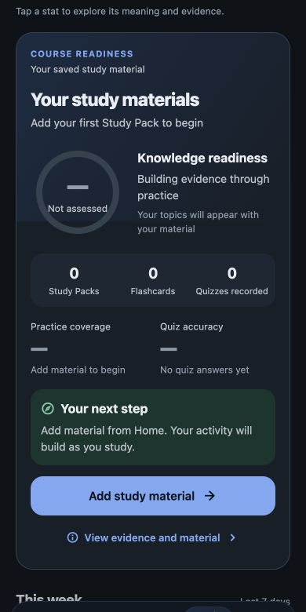

# StudyBolt Stats audit and frontend redesign — November 8, 2026

## Outcome and scope

The Stats page now starts with course-specific recall evidence and a working next study action. The overview emphasizes four useful measures and a simple weekly activity chart. More detailed progress, learning patterns, research, and time breakdowns are available through the existing six tabs and clearly labeled disclosures.

Counts remain visible at zero. Unassessed percentages use a dash. Empty libraries and uploaded-but-unpracticed material keep the page structure visible. Reading time remains included in recorded study activity.

This is a simulated multidisciplinary product review by Codex, using the Apple, Meta, educational UX, and engineering perspectives requested in the brief. It is not an external review by employees of those companies. No retention improvement, scientific validation, or exam outcome is claimed.

Only Stats UI, its read-only presentation projection, explanations, a single navigation call site, relevant tests, and documentation were changed. The existing three modified iOS project/plist files were present before this work and were not edited.

## Audit and evaluation

Scores are qualitative review judgments, not measured user-study results. The baseline was assessed from the implementation and data flow. Final visual judgments also use the local React Native Web preview at 390-pixel and 320-pixel widths, using 844- and 568-pixel browser height overrides. Browser chrome reduces the content area; the saved images are 390 × 780. Native iPhone sign-off remains pending.

| Criterion and review standard | Before | After | Evidence |
| --- | ---: | ---: | --- |
| Visual quality: hierarchy, spacing, typography, calm surfaces, small-screen fit | 6.5/10 | 8.5/10 | Shorter introduction, course-first card, consistent theme tokens, wrapping section headings and course names, light/dark screenshots |
| Usability: discoverable sections, understandable values, working actions, accessible controls | 6/10 | 8.5/10 | All six tabs visible, 44-point course arrows, clear disclosures, tested practice navigation and detail sheets |
| Learning value: distinguish activity from recall, explain uncertainty, use actual evidence | 6.5/10 | 8.5/10 | Conservative course evidence preserved; progress labels corrected; unassessed topic values masked; unsupported weighted forecast retired from Stats |
| Retention support: useful reasons to return, low friction to practice, supportive feedback | 5.5/10 | 8/10 | Real topic review and quiz actions, visible activity, genuine practice counts, optional streak detail and nonjudgmental habit language |

The requested 9.5-quality target was treated as a design standard. A 9.5 score is not asserted without native accessibility, touch, and student usability checks.

### Main problems found

1. Long introductory notices and a horizontally hidden tab strip delayed access to the course summary.
2. The top recall estimate and the lower “overall mastery” composite meant different things. The latter includes notes coverage and self-ratings.
3. A projected readiness percentage and weighted readiness formula implied greater certainty than the underlying data supports.
4. The former course action opened an explanation but did not start studying.
5. Eleven overview cards competed for attention before the student reached a useful next step.
6. Some unpracticed concepts and topics could display a small percentage derived from the “new” confidence baseline.
7. Secondary headings squeezed their title beside metadata on small phones. Some cards truncated names or shrank text.
8. Time charts exposed raw fractional minutes and used minimum visible bar heights that distorted small nonzero values.
9. Some labels implied more than was measured: “productive” time was the time with most activity; “slides reviewed” was a coverage approximation; retention copy rounded a 6.5-day threshold into an asserted seven-day threshold.
10. Empty class/pack time sections could render blank cards.

### Elements preserved

The six Stats sections, current account context, personal/sample distinction, detailed quiz history, actual activity totals, Study Pack coverage, recall and retention history, explanation sheets, theme system, and existing study destinations remain available. Existing scoring and review schedules were not changed.

## Implemented design decisions

### Course readiness

- A restrained gradient uses existing theme colors. Each page contains its actual course name, source material summary, recall ring, pack/card/quiz counts, practice coverage, first-answer quiz accuracy, and a specific next step.
- Native horizontal paging, stable course IDs, bounded previous/next arrows, and small position indicators remain. Selection survives resizing or course reordering; removing a course safely selects an available course. A single course omits redundant arrows.
- Long course names wrap. Narrow layouts stack the ring and status. Larger text switches supporting metrics to a vertical layout.
- The readiness rule is unchanged: all current packs need complete source-topic mapping and ready practice tools; each identified topic needs at least two distinct items; every mapped item needs first responses on separate UTC days at least 24 hours apart within 30 days. A supported topic requires each item's two latest daily responses to succeed, including a successful spaced response. Only complete assessment coverage unlocks the unweighted share of supported topics.
- A dash remains until that rule is satisfied. This is a conservative reporting rule about saved, identified material, not a validated assessment of the entire syllabus.
- Quiz-run counts deduplicate event IDs across packs in a course. A mixed assessment can count once in each course with an explicitly attributable valid answer. Invalid/future events, ambiguous multi-pack answers, demo packs, and seeded history are excluded from personal course evidence. Legacy aggregate scores do not create question-level accuracy.
- Failed or processing practice tools are described clearly. Recommendations select ready tools only.
- A missed source topic opens only that topic's existing flashcards when available. Otherwise a ready quiz opens for its actual source pack. Quiz actions are labeled as pack practice because the existing quiz route does not accept a topic filter. Unpracticed packs get a baseline-practice action; ready simplified notes are an honest fallback.
- “Add study material” opens the existing Home destination. No route names or study tools were added.

### Overview and detailed sections

- The overview shows study time, active study days, recent quiz average, and recorded question count first. A weekly chart and cross-course next steps follow.
- Remaining overview metrics and class progress live in named, accessible disclosures. They are available before study data exists.
- Advanced learning patterns, recall changes, research, and time allocations are also grouped into disclosures. Core results remain visible.
- The lower composite is labeled **Study progress** and its exact existing notes/cards/quiz/test weights are explained. Class composites use the same terminology.
- The weighted exam-readiness formula and projected exam percentage are no longer displayed by Stats. Their underlying services and any other consumers were not modified.
- The former retention-confidence percentage is replaced by qualitative **Evidence history**. The consistency percentage is replaced by an observed **Active weeks** count, calculated from the last 28 displayed activity days so it stays within four seven-day windows.
- Unseen concepts and unpracticed personal topics display a dash. Distribution percentages also use a dash when there is no population. An actual measured zero remains zero.
- More activity labels say **Most active day/time**. The approximate slide counter says **Page coverage estimate**, with its real calculation. Saved-class counts include real classes without packs; presentation counts use the course projection's source filenames.
- Retention explanations now state the existing detailed-view thresholds accurately: at least 18 hours for repeat-review retention, and at least 6.5 days for its longer-delay group. These are separate from the course card's 24-hour rule.

### Charts, accessibility, motion, and performance

- Charts use proportional bar heights, readable weekday labels, and formatted time values. A single generous chart target opens the complete value breakdown instead of seven narrow targets.
- Larger text uses a readable list layout for chart values and a single column for metric, compact-stat, calibration, and accuracy-breakdown cards. Names and values can wrap.
- Course buttons have 44 × 44 targets; primary actions have a minimum height of 50. The local accessibility tree exposes the selected course's content, and course changes are announced.
- The detail sheet hides the background Stats content from accessibility while open. Descriptions explain dashes, current values, calculations, and appropriate use.
- The existing Reduce Motion hook governs automatic paging and ring transitions. Native rings animate only between actual previously displayed values, never from an invented starting percentage. Web uses a static SVG ring to avoid forwarding native animation props into the DOM.
- Data projections are memoized and derived once at the screen level. The carousel renders a small window of pages. Foregrounding refreshes time-sensitive projections; no polling or network requests were added.
- Shared colors retain the existing contrast-tested palette. Unavailable cards keep their full surface opacity; only the value uses the muted text color.

## Data and account boundaries

Stats reads the current StudyBolt provider only. The application already remounts that workspace when the authenticated account changes, and persistence uses account-specific storage keys. This work adds no database reads, writes, storage keys, or account-selection controls.

The detailed personal view retains the existing sample and mixed-session filter. Course cards always exclude demo and seeded material, even when the optional all-data view is selected. Study actions re-resolve their pack from the current account's state and reject missing or demo packs; targeted card IDs are checked against the current pack.

The existing account-storage, AI isolation, personal-statistics, and learning-evidence tests remain passing. This verifies the relevant local boundaries and adds no new ability to access another account. It is not a substitute for a separate application-wide security audit.

## Exact delivered files

| File | Change |
| --- | --- |
| `src/screens/StatsScreen.tsx` | Page hierarchy, scope UI, loading, overview, disclosures, accurate labels, responsive layouts, chart/detail interactions, current-pack action validation |
| `src/components/LearningMasteryHero.tsx` | Course card design, counts, bounded carousel, recall ring, real practice actions, error states, native/web SVG handling |
| `src/services/learningMastery.ts` | Read-only quiz/card counts, practice-topic IDs, ready action metadata, failed-tool counts; existing readiness rule preserved |
| `src/data/statExplanations.ts` | Accurate explanations for the new labels and existing retention thresholds |
| `src/navigation/StudyBoltNavigator.tsx` | One Stats call-site change supplying the existing open-deck handler and Home-tab action |
| `tests/learningMastery.test.mjs` | Three regression tests for multi-pack counting, targeted source-card navigation, and ready-tool/reading-evidence boundaries |
| `docs/stats-learning-mastery.md` | Marks the previous report as historical and links this audit |
| `docs/stats-product-audit-2026-11-08.md` | This report |
| `docs/stats-audit-2026-11-08/course-light.jpg` | Local test-data visual review |
| `docs/stats-audit-2026-11-08/empty-dark.jpg` | Local empty-state visual review |

## Verification

| Check | Result |
| --- | --- |
| Baseline TypeScript and existing suite | Passed; 170 tests |
| Final TypeScript | Passed |
| Final full existing suite plus regression cases | Passed; 173 tests, zero failures |
| Relevant evidence tests | All 22 passed |
| Lint | No lint script or lint configuration is provided; none was added |
| Scoped whitespace checks | Passed |
| One and multiple courses | Browser preview passed; a single course omits paging controls |
| Long names at 320- and 390-pixel widths | Browser preview passed with compact height overrides; names wrap and controls remain usable |
| Horizontal and vertical scrolling | Browser preview passed; selection and surrounding vertical scrolling work |
| Actual review and quiz navigation | Browser preview passed; correct pack/tool opened, selected-topic card IDs retained, Back returned to Stats |
| Empty library and uploaded material without practice | Browser preview passed; real counts stay visible and unassessed results remain dashes |
| All six tabs, disclosures, chart breakdown, detail sheet, scope toggle, Add material | Browser preview passed |
| Light and dark themes | Browser preview passed; screenshots below |
| Account/sample boundaries | Existing isolation tests plus current source review passed; no production or private account records used |
| Reduce Motion, native Dynamic Type, VoiceOver, iPhone gestures | Code paths reviewed; actual device verification remains pending |

The browser preview used a temporary entry and isolated disposable guest fixtures on a local origin. Supabase, processor, and Sentry connections were disabled for that preview. The temporary entry, HTML page, and development server were removed or stopped after verification. No native build, backend deployment, store submission, dependency, signing, EAS, RevenueCat, or production configuration change was made.

The preview initially exposed native SVG prop warnings. Stats' web SVG path was corrected; entering Stats then added no captured console errors. An existing application/Home accessibility-prop warning was present before entering Stats and was left outside this task's scope.

## Remaining limitations and recommendations

- An iPhone simulator could not run in this environment. Before release, verify native touch snapping versus vertical scrolling, VoiceOver focus and announcements, large Dynamic Type, Reduce Motion, safe-area layout, and ring rendering on a real device or working simulator.
- The 9.5 target needs native and student usability evidence. No instrumented performance or long-term engagement study was run.
- Course readiness covers identified topics in saved material. Complete syllabus coverage, semantic deduplication between separate uploads, validated pass probabilities, and calibrated knowledge assessment require additional evidence and are not claimed.
- Existing detailed recall, learning-rate, fatigue, and efficiency estimates remain descriptive heuristics. Their underlying scores and schedules were preserved.
- The existing state does not supply a durable unfinished-quiz resume destination. No fake “Continue unfinished quiz” action was added.
- Add-material navigation uses Home's existing flow; it does not preselect a course. No new upload or class route was introduced.

## Visual review

These images use local test fixtures. The percentage shown in the populated image is not a real student's production result.

